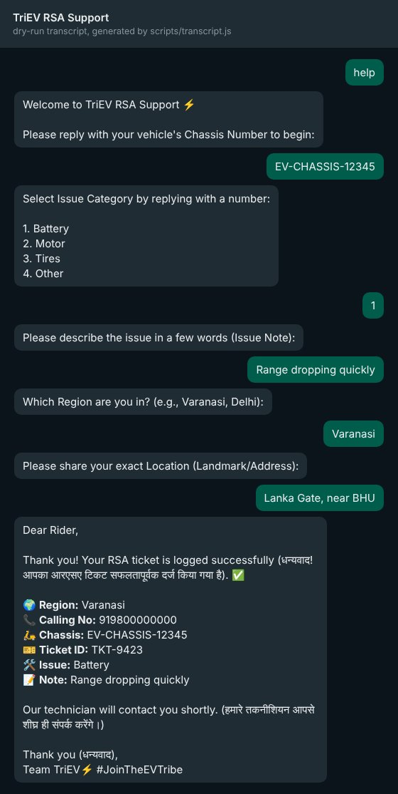

# TriEV WhatsApp RSA Bot

A WhatsApp bot that logs roadside-assistance (RSA) tickets for electric-scooter riders. A rider sends `help`, answers five short questions, and gets a ticket ID back in English and Hindi. The ticket lands in a Google Sheet that the operations team reads through AppSheet.

Built as a prototype during my time at TriEV (Nov 2025 – Feb 2026) to replace tickets being typed in by hand.



## How it works

```
Rider (WhatsApp) ──► Gupshup gateway ──► POST /webhook ──► flow.step() ──► reply via Gupshup
                                                               │
                                                               └─ last answer ─► Apps Script ─► Google Sheet ─► AppSheet
```

| Step | Bot asks | Stored as |
| --- | --- | --- |
| trigger | rider sends `help` | `riderMobile` |
| 1 | chassis number | `chassis` (upper-cased) |
| 2 | issue category: `1` Battery, `2` Motor, `3` Tires, `4` Other (names work too) | `issueCategory` |
| 3 | short description | `issueNote` |
| 4 | region | `region` |
| 5 | exact location | `location` |
| done | bilingual confirmation | `ticketId`, `ticketDate`, `callingMobileNo` |

Sending `help` again at any point restarts the form. A conversation left idle for 30 minutes is dropped.

## Layout

| Path | Role |
| --- | --- |
| `src/bot/flow.js` | The conversation as a pure function: `step(session, text, phone) → { session, replies, ticket }`. No network, no globals, so it is fully unit-tested. |
| `src/controllers/webhook.js` | Parses both Gupshup payload shapes, runs the flow, sends replies, saves the ticket. |
| `src/services/gupshup.js` | Outbound messages (Enterprise Gateway REST API). |
| `src/services/database.js` | Ticket save to the Apps Script endpoint. |
| `src/services/sessions.js` | In-memory session store with TTL. |
| `src/config.js` | Reads everything from the environment. |

## Run it

```bash
npm ci
cp .env.example .env     # leave the Gupshup fields blank for a dry run
npm start                # http://localhost:3000
npm run simulate         # in a second terminal: plays a whole conversation
```

With no credentials the bot runs in **dry-run**: replies are logged instead of sent and tickets stay in memory, so the whole flow can be tried without a WhatsApp number.

```bash
npm test                     # 8 tests: flow, sessions, payload parsing, end-to-end dry run
node scripts/transcript.js   # regenerates docs/transcript.html
```

## Configuration

| Variable | Purpose |
| --- | --- |
| `GUPSHUP_ACCOUNT_ID`, `GUPSHUP_PASSWORD` | Gateway credentials. Blank means dry-run. |
| `SHEET_WEBHOOK_URL` | Apps Script web-app URL that appends a row to the sheet. |
| `WEBHOOK_SECRET` | Optional. If set, the webhook only accepts `POST /webhook?secret=<value>`. |
| `SESSION_TTL_MINUTES` | Idle time before a half-finished conversation is dropped (default 30). |
| `DRY_RUN=1` | Force dry-run even with credentials present. |

Secrets live in `.env`, which is git-ignored. Never commit it.

## Known limits

- Sessions are in memory: a restart loses conversations in progress, and it cannot run on more than one instance without moving them to Redis.
- Ticket IDs are random four-digit numbers, so collisions are possible at volume. A sequence in the sheet would fix that.
- The technician-group alert from the original brief is not built.
- The webhook is open unless `WEBHOOK_SECRET` is set.
- Status: prototype. It was exercised with simulated payloads; treat the live Gupshup send path as untested until you have run it against your own account.
